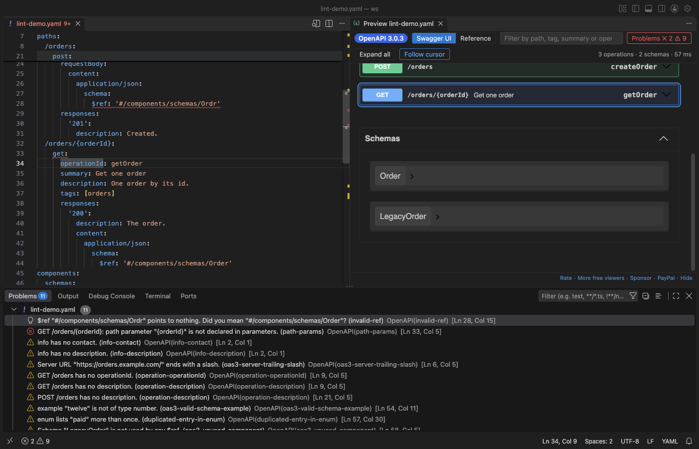
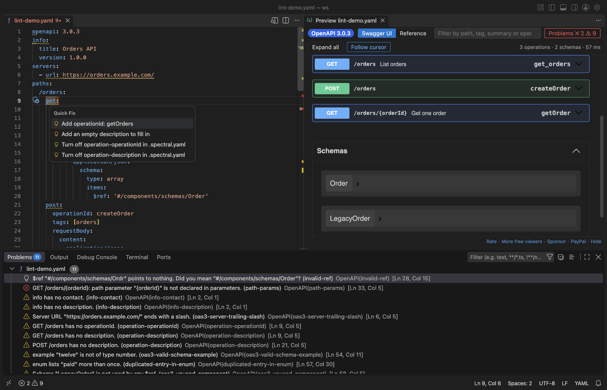
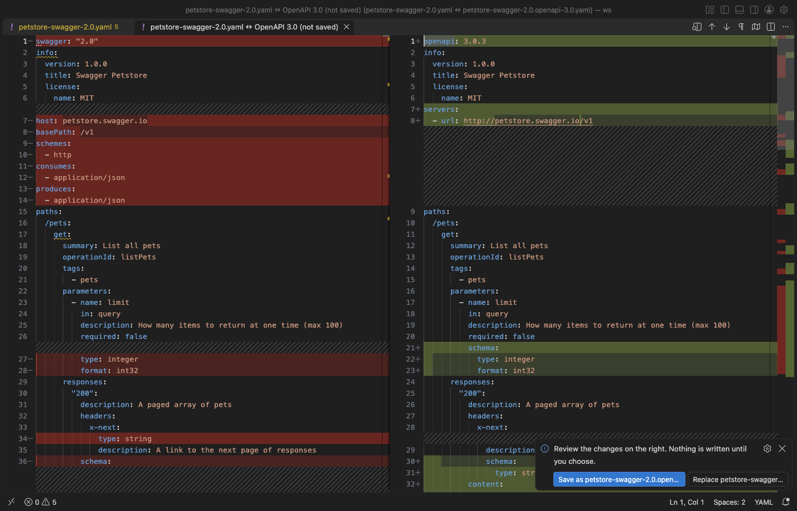
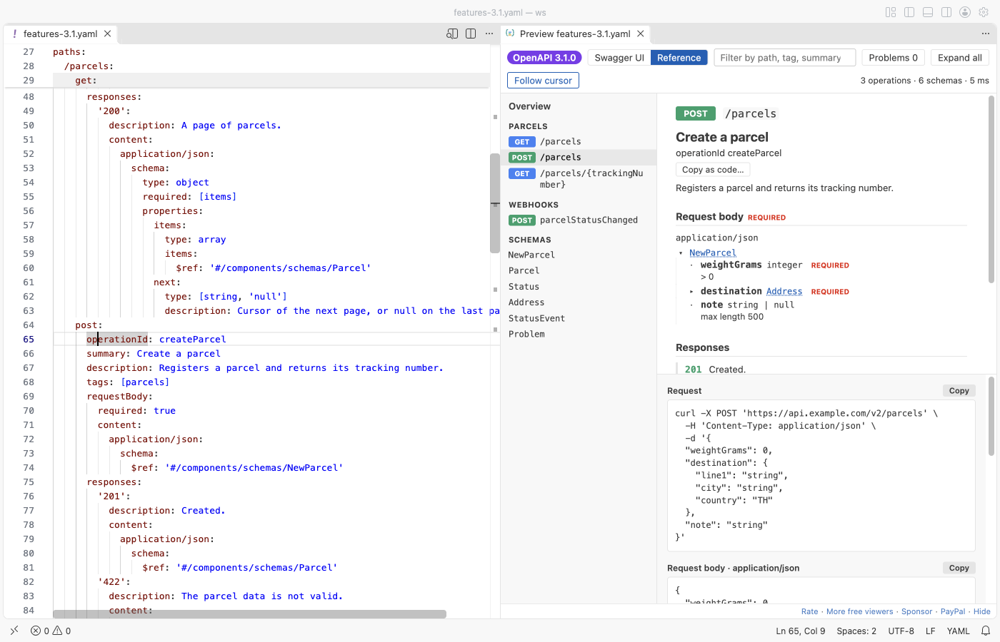

# Swagger Editor & OpenAPI Editing (Lint, Spec Preview, 3.1)

Edit OpenAPI 3.1, 3.0 and Swagger 2.0 files in VS Code with lint you can read, quick fixes, IntelliSense and a live Swagger UI preview that follows your cursor. YAML or JSON. Free, no sign-in, works offline: no account, no telemetry, and nothing is sent unless you click Send in Try it out.

*A real file (`samples/lint-demo.yaml`) in VS Code 1.142, dark theme. The cursor is in `getOrder`, so the preview scrolls to that operation and marks it. The Problems panel lists the lint results with their rule names.*

## Start

1. Open a `.yaml` or `.json` file that has `openapi:` or `swagger:` at the top. Lint runs at once; problems show in the Problems panel.
2. Click the preview button at the top right of the editor, or press `Shift+Alt+P`.
3. Move the cursor in the spec: the preview shows that operation or schema. Click an operation in the preview: the cursor goes to its line.

Right-click in a spec and open the OpenAPI menu for convert, bundle, compare, mock server and client code.

## Why this one

The most installed OpenAPI extension is good, and it has many users. Its reviews and issues still list problems that this extension fixes. Each line below links the report and says what is different here; the real VS Code test of this release checks each one.

| Reported problem | Here |
|---|---|
| OpenAPI 3.1 does not work: a [review](https://marketplace.visualstudio.com/items?itemName=42Crunch.vscode-openapi&ssr=false#review-details) from 28 Oct 2024 says "not working for OpenAPI Version 3.1.0"; issues [110](https://github.com/42Crunch/vscode-openapi/issues/110) (open since 2021, 63 comments), [issue 319](https://github.com/42Crunch/vscode-openapi/issues/319) and [issue 369](https://github.com/42Crunch/vscode-openapi/issues/369) | 3.1 is the default. `webhooks`, `type: [string, "null"]`, `jsonSchemaDialect`, `const`, `examples` and `license.identifier` parse, lint and preview. The test file has all of them: 0 errors, webhook shown. |
| Multiline descriptions do not show in the preview: a [review](https://marketplace.visualstudio.com/items?itemName=42Crunch.vscode-openapi&ssr=false#review-details) from 10 Jul 2024 | `description: \|` blocks render as Markdown, with lists and line breaks, in both layouts. |
| A schema from another file shows its file path as its name in the preview: issue [194](https://github.com/42Crunch/vscode-openapi/issues/194) (open) | The bundler keeps the schema name (`Pet`, not a path) and puts it under `components/schemas`. |
| A split spec loses completions: issue [82](https://github.com/42Crunch/vscode-openapi/issues/82) (open) | `$ref` completion lists the files of your workspace and the components inside them. Go to definition and rename work across files. |
| The preview does not refresh: issue [199](https://github.com/42Crunch/vscode-openapi/issues/199) (open) | The preview updates while you type, and when you save any file the spec refers to. |
| "I see nothing better than online version": a [review](https://marketplace.visualstudio.com/items?itemName=42Crunch.vscode-openapi&ssr=false#review-details) from 9 Mar 2025 | The preview follows the cursor, and a click in the preview moves the cursor. An online editor cannot jump to a line in your file. |

This extension does not do an API security audit. That needs a security platform.

## Lint with rules you can read

- Each problem names its rule (for example `operation-operationId`, `oas3-unused-component`, `invalid-ref`) and says what to change. The rule names follow the Spectral OpenAPI ruleset.
- Quick fixes (`Ctrl+.` or `Cmd+.`): add a missing `operationId`, `summary` or `description`, remove an unused component, replace a `$ref` that points nowhere with the closest existing name, or turn a rule off.
- A `.spectral.yaml` in the workspace folder sets the severity of each rule (`off`, `hint`, `info`, `warn`, `error`). Custom Spectral functions are not run; they are listed as skipped.
- Lint runs in a background thread, also with the preview closed. The 8 MB Stripe spec lints while you keep typing.

## Edit

- IntelliSense: the keys that are valid at the cursor (operation, parameter, schema and so on, for 2.0, 3.0 and 3.1), values such as `in: query` or `type: string`, HTTP methods and status codes.
- `$ref`: completion of local components and of files in the workspace, go to definition (`F12`), a hover with the target, and rename a schema with every `$ref` to it (`F2`), across files.
- Outline: paths, operations, webhooks and components in the Outline view and in `Cmd+Shift+O`.

## Preview

- Two layouts: Swagger UI, or a reference layout with operations on the left, details in the middle and examples on the right.
- Follow cursor: on by default. The toolbar button turns it off.
- Problems list in the preview, with file and line. Click one to go there.
- Filter by path, tag, summary or `operationId`. Press `/` to jump to the filter box.
- Large specs: the 11 MB GitHub REST API description (1,000+ operations) opens in a few seconds. Specs over 3 MB open in the reference layout, which draws one operation at a time; Swagger UI is one click away.
- Dark and light from your VS Code theme.

## Convert, bundle, compare

- Convert Swagger 2.0 to OpenAPI 3.0, and OpenAPI 3.0 to 3.1 (`nullable` becomes a type list, `example` becomes `examples`, and so on).
- Bundle a spec split over many files into one file.
- Compare versions: a list of the changes that can break a client (an operation removed, a new required field, a type changed) against a git ref such as `HEAD` or `main`, or against another file.

Every change opens as a diff first. Nothing is written until you click Save as or Replace.

## Try it out, mock server, client code

- Try it out is off by default. Turn on `openapiViewer.tryItOut`, then click Execute in Swagger UI. VS Code asks before it sends the request, and sends only to hosts on `openapiViewer.tryItOutAllowedHosts` (local hosts by default). A request to another host, for example a production server, is not sent.
- Mock server: serves the example responses of the spec on `127.0.0.1` (port 4010 by default), so a front end can call it before the API exists. It stops with one click in the status bar.
- Client code for an operation in 10 languages: curl, JavaScript fetch, Node axios, Python requests, Go, Java, C#, PHP, Ruby and Swift. The cursor picks the operation.

## Safety

- The preview has a strict Content Security Policy: no remote scripts, images, fonts or connections.
- Markdown in descriptions cannot run scripts.
- `$ref` paths outside the workspace, absolute paths, `file:` URLs and symlinks that lead out of the workspace are not read.
- Remote `$ref`s (`http`, `https`) load only after you click Load remote refs, and local or private addresses (such as `169.254.169.254`) are never loaded.
- YAML files with too many aliases (a "billion laughs" file) stop with a message.
- In Restricted Mode, Try it out, the mock server and git compare stay off.

## Settings

| Setting | Default | What it does |
|---|---|---|
| `openapiViewer.lint.enabled` | `true` | Lint OpenAPI and Swagger files |
| `openapiViewer.lint.whenPreviewClosed` | `true` | Also lint files that have no preview open |
| `openapiViewer.preview.followCursor` | `true` | The preview follows the cursor, a click in the preview moves the cursor |
| `openapiViewer.defaultLayout` | `auto` | `swagger`, `reference`, or `auto` (reference for large specs) |
| `openapiViewer.updateDelayMs` | `400` | Wait after typing before the preview updates |
| `openapiViewer.maxFileMB` | `64` | Largest file that is read |
| `openapiViewer.largeSpecMB` | `3` | With `auto`, larger specs open in the reference layout |
| `openapiViewer.remoteRefs` | `ask` | `ask` shows the Load remote refs button, `never` turns remote refs off |
| `openapiViewer.tryItOut` | `false` | Show Try it out in Swagger UI |
| `openapiViewer.tryItOutAllowedHosts` | local hosts | Hosts that Try it out may send to |
| `openapiViewer.mock.port` | `4010` | Port of the mock server on 127.0.0.1 |
| `openapiViewer.swaggerUi.docExpansion` | `list` | What Swagger UI opens at first |
| `openapiViewer.showProblemsInEditor` | `true` | Show problems in the Problems panel and as squiggles |

## Privacy

The extension makes no network calls. The exceptions are your own clicks: Send in Try it out, Load remote refs, and Unlock with GitHub Sponsors if Zovo Pro is ever switched on for this extension (one call to GitHub). A license key is checked on your computer. The mock server listens on 127.0.0.1 only.

## Free and Pro

Everything above is free today, including the breaking-change report, the mock server and client code. Opening, viewing, editing, lint, quick fixes, IntelliSense, the preview, Try it out, convert and bundle will stay free. Zovo Pro is USD 19 once on its GitHub Sponsors tier (https://github.com/sponsors/theluckystrike/sponsorships?tier_id=679878). If Pro is switched on later, it can cover only the breaking-change report, the mock server and client code.

## Limits

- Lint covers the common mistakes and the Spectral OpenAPI rule names. It is not a full JSON Schema validation of the OpenAPI schema, and custom Spectral functions do not run.
- Try it out does not send file uploads (multipart) from the preview.
- Convert works on the root file. Files it refers to keep their content; the notes in the output panel list them.

Also on Open VSX, so it works in Cursor, Windsurf, VSCodium and other editors based on VS Code.

## Support Zovo

Zovo extensions are free, with no ads and no tracking. They are made by [theluckystrike](https://github.com/theluckystrike) on GitHub. If this one saves you time, you can support the work:

- [Sponsor on GitHub](https://github.com/sponsors/theluckystrike)
- [PayPal](https://www.paypal.com/paypalme/najzzz)
- [Follow theluckystrike on GitHub](https://github.com/theluckystrike)

## More tools by Zovo

- [Load Testing & HTTP Load Tests for APIs](https://github.com/theluckystrike/load-testing-vscode) Load tests for HTTP APIs inside VS Code. Imports OpenAPI specs, shows requests per second and p95 latency live.
- [HAR Viewer & HAR File Analyzer (HTTP Archive, Network Log)](https://marketplace.visualstudio.com/items?itemName=zovo.zovo-har-viewer) Opens HAR files from browser DevTools with a timing waterfall, filters and a redacted copy for sharing.
- [Large JSON Viewer, JSON Browser & JSON Tree](https://marketplace.visualstudio.com/items?itemName=zovo.zovo-json-tree-viewer) Shows large JSON files as a searchable tree, copies JSONPath and turns arrays of objects into a table.
- [JSONL Viewer, Large JSONL Table & NDJSON Viewer](https://marketplace.visualstudio.com/items?itemName=zovo.zovo-jsonl-viewer) Opens JSONL and NDJSON files as a table, as records or as a chat view.
- [Graphviz Viewer & DOT Viewer (Live Preview)](https://marketplace.visualstudio.com/items?itemName=zovo.zovo-graphviz-preview) Shows a live preview of DOT files and exports SVG or PNG.

See [all Zovo extensions on the Marketplace](https://marketplace.visualstudio.com/publishers/zovo).

## License

MIT. Swagger UI is Apache-2.0 and yaml is ISC; see [THIRD-PARTY-NOTICES.md](THIRD-PARTY-NOTICES.md).

## More from zovo

- [All free zovo VS Code extensions](https://marketplace.visualstudio.com/publishers/zovo) — file viewers, database clients, formatters. Offline, no telemetry, no sign-up.
- [Full MCP server catalogue](https://theluckystrike.github.io/mcp/) — local-first MCP servers for back-office work: invoices, VAT, PDFs, spreadsheets, payroll.
- [Hosted no-install MCP endpoints](https://mcp.zovo.one) — paste a URL in Claude / Cursor, nothing to install.
