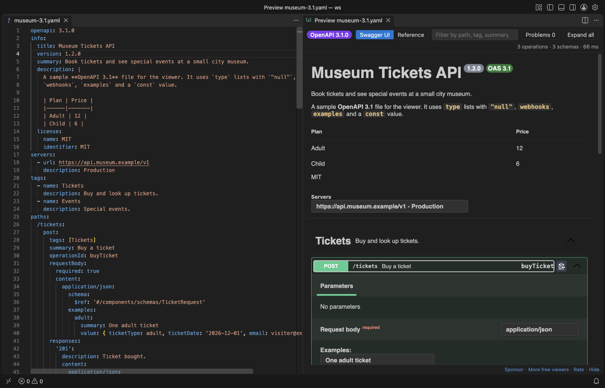
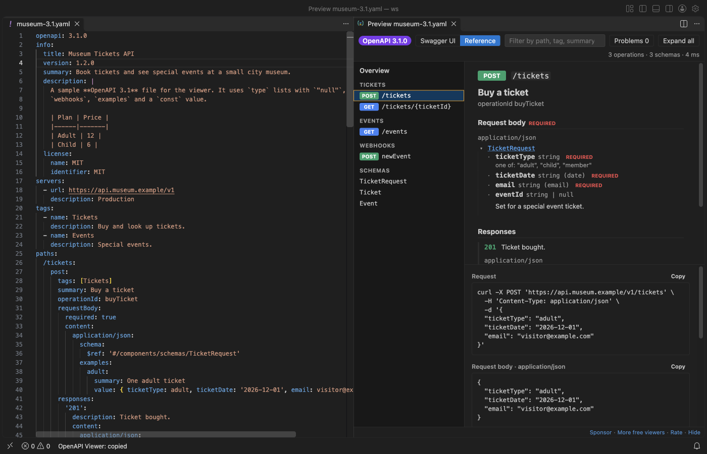
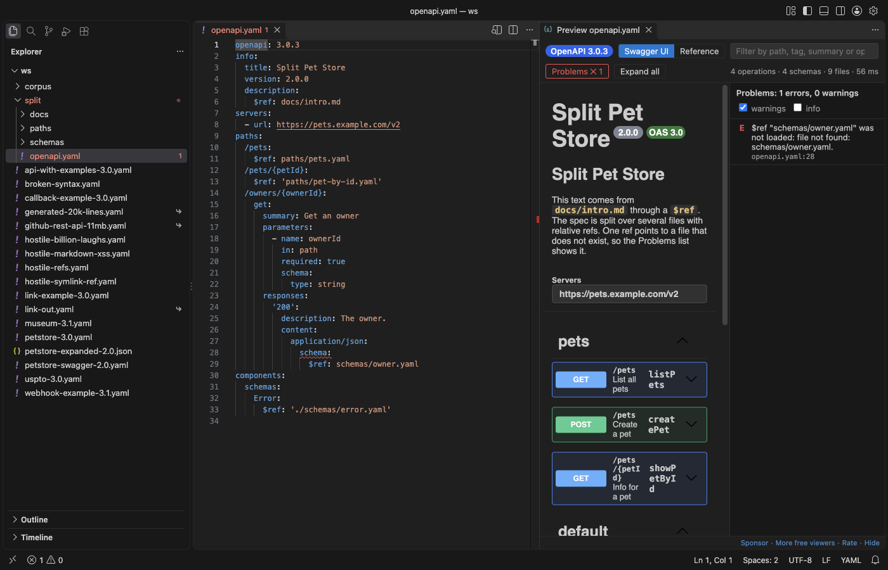

# Swagger Viewer & OpenAPI Viewer (OpenAPI Preview, 3.1, $ref)

A live Swagger UI preview for OpenAPI 3.1, 3.0 and Swagger 2.0 files in VS Code, in YAML or JSON. Free, no sign-in, works offline: no local server, no port, and the preview makes no network requests.

*A real file (`samples/museum-3.1.yaml`) next to its preview in VS Code 1.142, dark theme.*

## Open a preview

- Click the preview button at the top right of a YAML or JSON file that starts with `openapi:` or `swagger:`.
- Or press `Shift+Alt+P`, or right-click the file in the Explorer and pick Open Preview to the Side.
- Or run OpenAPI Viewer: Open Preview to the Side from the Command Palette.

Each file gets its own preview, so you can keep several open at once.

## Why another Swagger viewer

The Swagger viewer most people install has not changed in almost a year, and its most discussed issues are still open. This one fixes them:

1. External `$ref` works: Relative refs to other files (`paths/pets.yaml`, `../schemas/pet.yaml#/Pet`) are read from your workspace and put into one document. Cycles across files stay cycles. A ref that cannot be loaded is listed with the file name and the reason, for example `file not found: schemas/owner.yaml`.
2. OpenAPI 3.1: Webhooks, `type: [string, "null"]`, `const`, `examples` and the 3.1 `license.identifier` show as they should. The version is in the toolbar.
3. Never a stale preview: It updates while you type (no save needed) and when you save any file the spec refers to. You can select and copy any text, and paste works in the filter box on macOS.

Other spec tools ask for an email address or an API key, or slow the editor down on big files. This one has no account, and the parsing runs in a background thread.

## Features

- Two layouts: Swagger UI, or a reference layout with the operation list on the left, the details in the middle and a curl line with request and response examples on the right. Switch in the toolbar.
- Problems with line numbers: Missing path parameters, duplicate `operationId`, undefined security schemes, refs that point nowhere, 3.0 and 3.1 keyword mix-ups, YAML and JSON syntax errors. Click a problem to go to the line, in the right file. They also show in the Problems panel.
- Filter by path, tag, summary or `operationId`. Press `/` to jump to the filter box.
- Large specs: The 11 MB GitHub REST API description (1,272 operations) opens in a few seconds, and typing in the editor stays smooth while the preview rebuilds. Specs over 3 MB open in the reference layout, which draws one operation at a time; Swagger UI is one click away.
- Dark and light from your VS Code theme.
- Remote refs only when you ask: `http(s)` refs show a Load remote refs button. Nothing is loaded before you click it, and local or private addresses (such as `169.254.169.254`) are never loaded.
- Try it out is off: Turn on `openapiViewer.tryItOut` to send requests from Swagger UI. VS Code sends them after you confirm each server.

## Safety

- The page has a strict Content Security Policy: no remote scripts, images, fonts or connections.
- Markdown in descriptions cannot run scripts. Swagger UI cleans it, and the reference layout shows it as plain text with formatting.
- `$ref` paths outside the workspace, absolute paths, `file:` URLs and symlinks that lead out of the workspace are not read.
- YAML files with too many aliases (a "billion laughs" file) stop with a message.

## Settings

| Setting | Default | What it does |
|---|---|---|
| `openapiViewer.defaultLayout` | `auto` | `swagger`, `reference`, or `auto` (reference for large specs) |
| `openapiViewer.updateDelayMs` | `400` | Wait after typing before the preview updates |
| `openapiViewer.maxFileMB` | `64` | Largest file that is read |
| `openapiViewer.largeSpecMB` | `3` | With `auto`, larger specs open in the reference layout |
| `openapiViewer.remoteRefs` | `ask` | `ask` shows the Load remote refs button, `never` turns remote refs off |
| `openapiViewer.tryItOut` | `false` | Show Try it out in Swagger UI |
| `openapiViewer.swaggerUi.docExpansion` | `list` | What Swagger UI opens at first |
| `openapiViewer.showProblemsInEditor` | `true` | Also show problems in the Problems panel |

## Limits

- The checks are the common mistakes, not a full JSON Schema validation of the OpenAPI schema.
- Try it out does not send file uploads (multipart) from the preview.
- Remote refs are loaded once per click, for the file that is open.

Also on Open VSX, so it works in Cursor, Windsurf, VSCodium and other editors based on VS Code.

## Support Zovo

Zovo extensions are free, with no ads and no tracking. They are made by [theluckystrike](https://github.com/theluckystrike) on GitHub. If this one saves you time, you can support the work:

- [Sponsor on GitHub](https://github.com/sponsors/theluckystrike)
- [Follow theluckystrike on GitHub](https://github.com/theluckystrike)

## More tools by Zovo

- [Large JSON Viewer, JSON Browser & JSON Tree](https://marketplace.visualstudio.com/items?itemName=zovo.zovo-json-tree-viewer) Shows large JSON files as a searchable tree, copies JSONPath and turns arrays of objects into a table.
- [HAR Viewer & HAR File Analyzer (HTTP Archive, Network Log)](https://marketplace.visualstudio.com/items?itemName=zovo.zovo-har-viewer) Opens HAR files from browser DevTools with a timing waterfall, filters and a redacted copy for sharing.
- [JSONL Viewer, Large JSONL Table & NDJSON Viewer](https://marketplace.visualstudio.com/items?itemName=zovo.zovo-jsonl-viewer) Opens JSONL and NDJSON files as a table, as records or as a chat view.
- [Graphviz Viewer & DOT Viewer (Live Preview)](https://marketplace.visualstudio.com/items?itemName=zovo.zovo-graphviz-preview) Shows a live preview of DOT files and exports SVG or PNG.
- [SQLite DB Viewer & SQLite Viewer, Database Viewer (Read-Only)](https://marketplace.visualstudio.com/items?itemName=zovo.sqlite-table-viewer) Browses SQLite tables read-only and runs SELECT queries.

See [all Zovo extensions on the Marketplace](https://marketplace.visualstudio.com/publishers/zovo).

## License

MIT. Swagger UI is Apache-2.0 and yaml is ISC; see [THIRD-PARTY-NOTICES.md](THIRD-PARTY-NOTICES.md).
